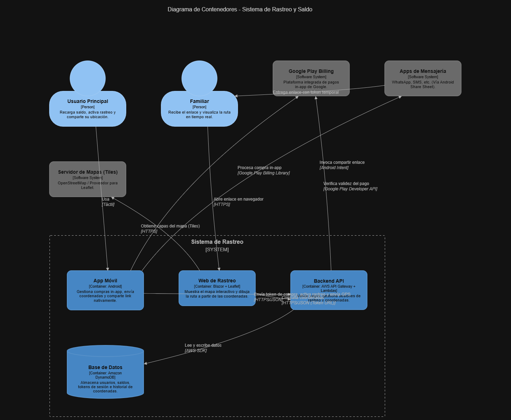
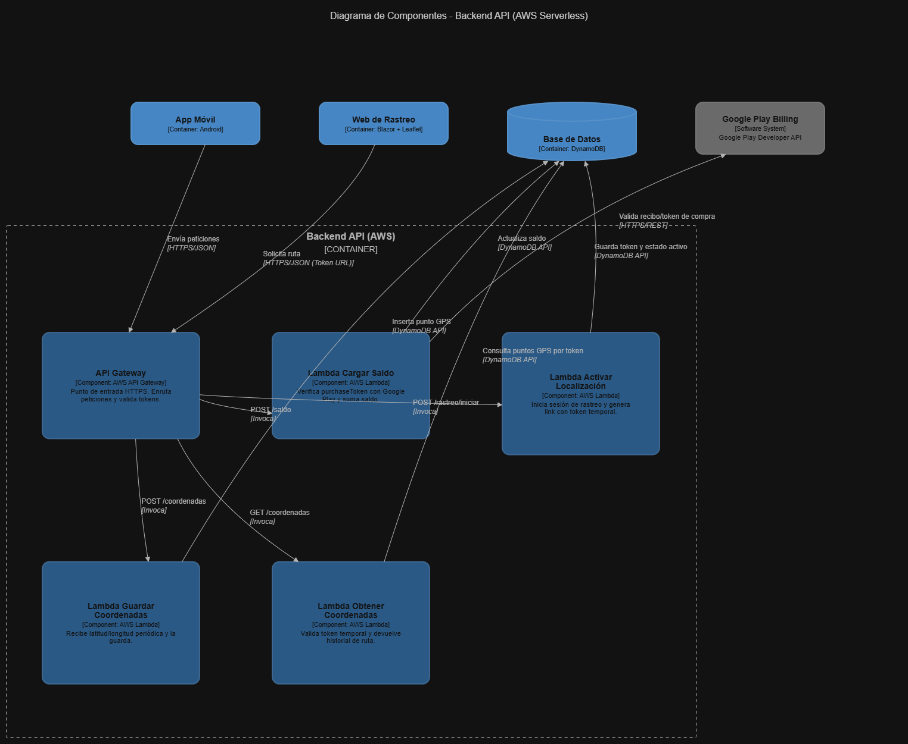

# 🛡️ App de Seguridad y Rastreo Familiar

Sistema de rastreo GPS en tiempo real basado en AWS Serverless que permite compartir temporalmente la ubicación de una persona mediante enlaces seguros protegidos por tokens temporales.

La solución utiliza una arquitectura completamente serverless sobre AWS para minimizar costos operativos, simplificar el mantenimiento y permitir escalabilidad automática.

---

# Arquitectura General

<p align="center">
  
</p>

---

# Arquitectura Backend

<p align="center">
  
</p>

---

# Características

- 📍 Rastreo GPS en tiempo real.
- 👨‍👩‍👧 Compartición de ubicación mediante enlaces temporales.
- 💰 Sistema de saldo prepago.
- 📱 Compras integradas mediante Google Play Billing.
- 🌎 Visualización de recorridos sobre mapas interactivos.
- ☁️ Backend completamente Serverless.
- 🔒 Tokens temporales para acceso a rutas.
- 📊 Historial de coordenadas.
- 📈 Escalabilidad automática mediante AWS.

---

# Descripción General

La aplicación permite que un usuario comparta temporalmente su ubicación con familiares o contactos de confianza.

El flujo principal es:

1. El usuario recarga saldo mediante Google Play.
2. Activa una sesión de rastreo.
3. El sistema genera un enlace único.
4. El enlace es compartido mediante WhatsApp, SMS o cualquier aplicación Android compatible.
5. El familiar accede al enlace.
6. La ubicación y ruta son visibles desde una aplicación web desarrollada en Blazor.

---

# Componentes del Sistema

## Usuario Principal

Responsable de:

- Comprar saldo.
- Compartir ubicación.
- Iniciar rastreos.
- Gestionar sesiones activas.

## Familiar

Responsable de:

- Abrir el enlace recibido.
- Consultar la ubicación en tiempo real.
- Visualizar el recorrido histórico.

## Aplicación Móvil Android

Funciones:

- Gestión de compras.
- Obtención periódica de GPS.
- Compartición de enlaces.
- Comunicación con AWS.

## Web de Rastreo

Aplicación construida con:

- Blazor
- Leaflet
- OpenStreetMap

Funciones:

- Consulta de coordenadas.
- Visualización de rutas.
- Actualización en tiempo real.

## Backend AWS

Compuesto por:

- API Gateway
- AWS Lambda
- DynamoDB

---

# Arquitectura Backend

## API Gateway

Punto único de entrada para todas las solicitudes.

Responsabilidades:

- Exponer endpoints HTTPS.
- Validar solicitudes.
- Enrutar tráfico hacia las Lambdas correspondientes.

### Endpoints

```http
POST /saldo
POST /rastreo/iniciar
POST /coordenadas
GET /coordenadas
```

---

## Lambda Cargar Saldo

Valida una compra realizada mediante Google Play Billing y actualiza el saldo disponible del usuario.

### Responsabilidades

- Recibir Purchase Token.
- Validar compra con Google Play Developer API.
- Actualizar saldo.
- Registrar la transacción.

### Ejemplo

```json
{
  "purchaseToken": "PURCHASE_TOKEN"
}
```

---

## Lambda Activar Localización

Responsable de iniciar una sesión de rastreo.

### Funciones

- Verificar saldo disponible.
- Crear sesión.
- Generar token temporal.
- Crear enlace compartible.

### Respuesta

```json
{
  "token": "abc123",
  "url": "https://rastreo.midominio.com/ruta/abc123"
}
```

---

## Lambda Guardar Coordenadas

Recibe coordenadas GPS enviadas por la aplicación móvil.

### Funciones

- Validar sesión.
- Registrar coordenadas.
- Almacenar historial.

### Ejemplo

```json
{
  "latitud": -3.99313,
  "longitud": -79.20422,
  "fecha": "2026-11-19T10:00:00Z"
}
```

---

## Lambda Obtener Coordenadas

Obtiene el historial GPS asociado a un token temporal.

### Funciones

- Validar token.
- Consultar coordenadas.
- Devolver recorrido.

### Ejemplo

```json
[
  {
    "latitud": -3.99313,
    "longitud": -79.20422
  },
  {
    "latitud": -3.99350,
    "longitud": -79.20490
  }
]
```

---

# Flujo de Carga de Saldo

```text
Usuario
   │
   ▼
Google Play Billing
   │
   ▼
Purchase Token
   │
   ▼
Lambda Cargar Saldo
   │
   ▼
Google Play Developer API
   │
   ▼
DynamoDB
```

### Proceso

1. El usuario realiza una compra.
2. Android recibe el Purchase Token.
3. Se envía al backend.
4. La Lambda valida la compra.
5. DynamoDB actualiza el saldo.
6. El usuario puede iniciar rastreos.

---

# Flujo de Inicio de Rastreo

```text
App Android
      │
      ▼
Lambda Activar Localización
      │
      ▼
DynamoDB
      │
      ▼
Generación de Token
      │
      ▼
URL Compartible
```

### Resultado

Ejemplo de URL:

```text
https://rastreo.midominio.com/ruta/abc123
```

---

# Flujo de Compartición

```text
App Android
      │
      ▼
Android Share Intent
      │
      ▼
WhatsApp
SMS
Telegram
Correo Electrónico
```

---

# Flujo de Captura GPS

```text
GPS Android
      │
      ▼
Lambda Guardar Coordenadas
      │
      ▼
DynamoDB
```

### Proceso

- Obtención periódica del GPS.
- Almacenamiento de puntos.
- Construcción del historial de recorrido.

---

# Flujo de Visualización

```text
Familiar
      │
      ▼
Abre Enlace
      │
      ▼
Web Blazor
      │
      ▼
Lambda Obtener Coordenadas
      │
      ▼
DynamoDB
      │
      ▼
Leaflet
      │
      ▼
Mapa y Recorrido
```

---

# Base de Datos

## Usuarios

```json
{
  "usuarioId": "123",
  "nombre": "Usuario",
  "saldo": 50
}
```

## Sesiones

```json
{
  "token": "abc123",
  "usuarioId": "123",
  "estado": "Activo",
  "fechaExpiracion": "2026-11-20T10:00:00Z"
}
```

## Coordenadas

```json
{
  "token": "abc123",
  "latitud": -3.99,
  "longitud": -79.20,
  "fecha": "2026-11-19T10:00:00Z"
}
```

---

# Tecnologías Utilizadas

## Frontend

- Android Native
- Blazor
- Leaflet
- OpenStreetMap

## Backend

- AWS Lambda
- AWS API Gateway
- Amazon DynamoDB

## Integraciones

- Google Play Billing Library
- Google Play Developer API

## Comunicación

- HTTPS
- REST API
- JSON

---

# Estructura del Proyecto

```text
.
├── README.md
│
├── docs
│   └── arquitectura
│       ├── DiagramaContenedoresAppSeguridad.png
│       └── DiagramaComponentesAppSeguridad.png
│
├── src
│   ├── MobileApp
│   ├── WebTracking
│   │
│   └── Backend
│       ├── LambdaCargarSaldo
│       ├── LambdaActivarLocalizacion
│       ├── LambdaGuardarCoordenadas
│       └── LambdaObtenerCoordenadas
│
└── Infrastructure
```

---

# Seguridad

- Comunicación cifrada mediante HTTPS.
- Tokens temporales de acceso.
- Validación de compras mediante Google Play Developer API.
- Acceso indirecto a DynamoDB.
- Arquitectura serverless sin exposición de servidores.
- Validación centralizada mediante API Gateway.

---

# Escalabilidad

La solución aprovecha servicios administrados por AWS:

- Escalado automático de Lambda.
- DynamoDB bajo demanda.
- API Gateway administrado.
- Sin costos de servidores permanentes.
- Pago por uso.

---

# Futuras Mejoras

- 🔔 Notificaciones Push mediante Firebase.
- 📍 Geocercas (Geofencing).
- 🚨 Botón de emergencia.
- 👨‍👩‍👧 Seguimiento para múltiples familiares.
- 📄 Exportación de recorridos a PDF.
- 📊 Dashboard administrativo.
- ☁️ Integración con CloudWatch.
- 📈 Estadísticas de uso.
- 🔗 Compartición mediante códigos QR.

---

# Ventajas de la Arquitectura

✅ Bajo costo operativo.

✅ Infraestructura completamente serverless.

✅ Escalabilidad automática.

✅ Pago por uso.

✅ Integración sencilla con Android.

✅ Arquitectura desacoplada.

✅ Fácil mantenimiento.

✅ Alta disponibilidad.

✅ Fácil incorporación de nuevas funcionalidades.
